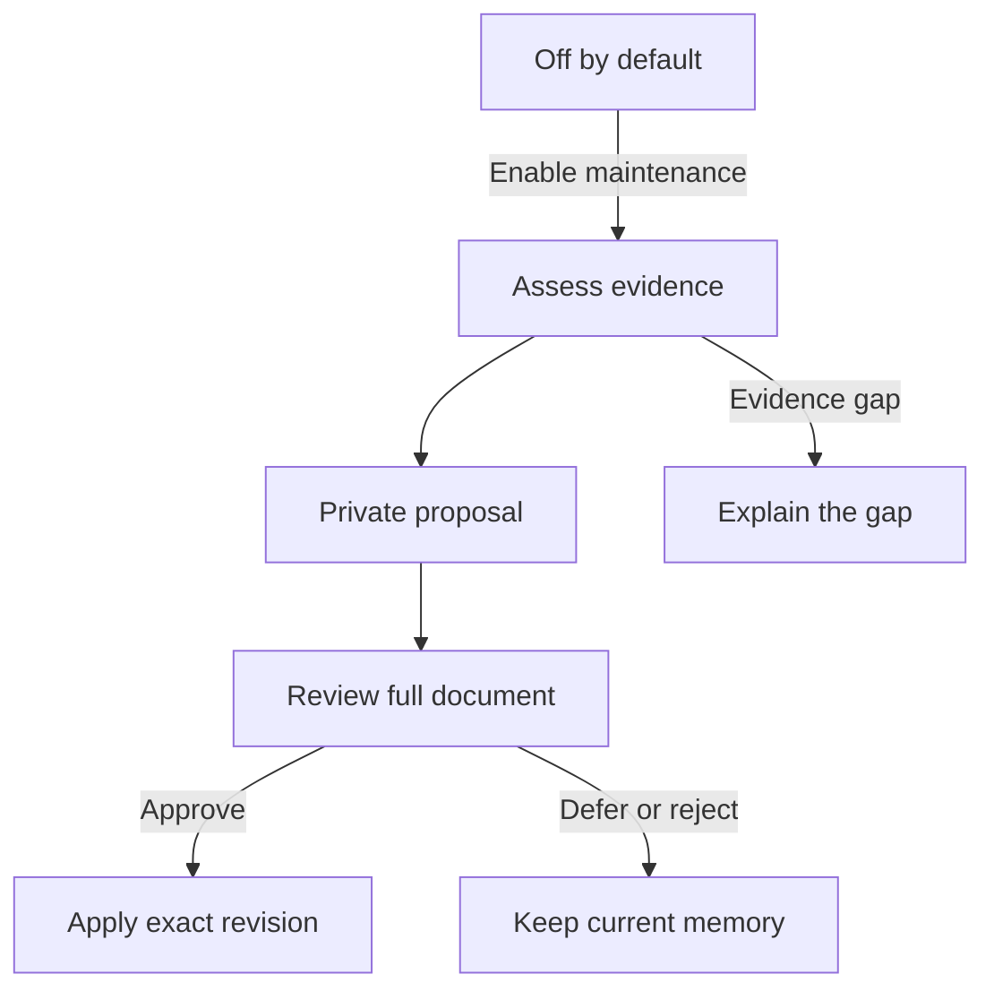
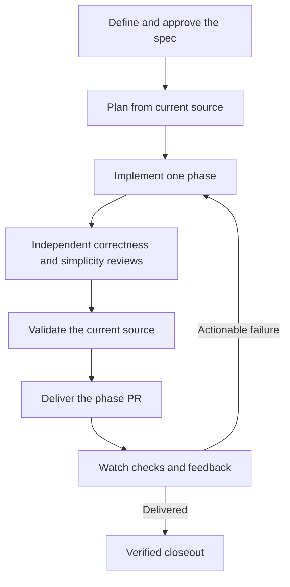
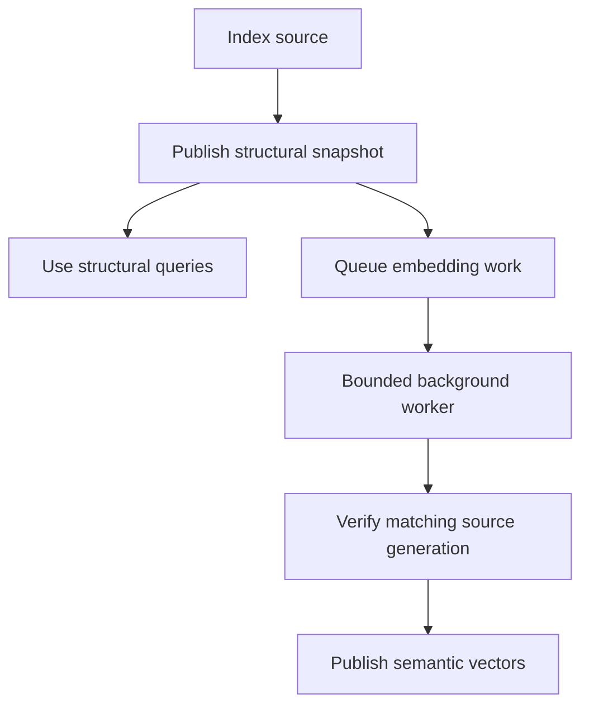

## What's new

Threadnote 5.3.0 adds reviewed memory maintenance, native development workflows, and a live Manager. It brings together the changes since 5.2.1, including safer shared-memory reconciliation, background graph embeddings, local model setup, and more compatible updates.

### Memory maintenance, with you in control

Automatic maintenance is now a **global setting and is off by default**. Enable it explicitly in Manager's Context Health view when you want Threadnote to assess eligible memories across your projects. Pausing does not wait for a long-running maintenance scan; work already running winds down safely.

Ordinary new and existing memories no longer need special topic enrollment to be assessed. When maintenance is enabled, Threadnote can collect accessible supporting evidence and, within a bounded generation budget, prepare a **private proposal**. An assessment is not a saved update: you review the complete proposed document and explicitly approve the exact revision before canonical content changes.



The review preserves protected policy and historical content, keeps factual changes separate from conflicts, and verifies the saved result. Missing, partial, inaccessible, or contradictory evidence remains visible. Threadnote does not accept drafts, expand their evidence scope, or publish memories automatically.

The default local drafting allowance is four generation units per rolling hour. Model and provider choices are preserved; remote background generation needs a separate finite grant. Global maintenance controls and drafting controls are separate:

```sh
# Inspect or pause maintenance across projects.
threadnote context maintain --action status --json
threadnote context maintain --action pause --json

# Explicitly enable maintenance when you are ready.
threadnote context maintain --action resume --json

# Inspect the separate background drafting state.
threadnote context maintain --action background-status --json
```

### Source-backed topics and private notes

Explicitly enrolled topics remain available when you want a declared maintenance boundary. Code-backed topics can detect changes in their supporting code, retain the evidence used for a proposal, and prepare a bounded update with your selected generation provider.

Private topics can also use a supported Obsidian note as evidence. You select and retain the supporting excerpt, inspect the proposed text, and separately approve the complete document. Source access and evidence problems block acceptance instead of silently authorizing a write.

You can review a bounded one-hop code neighborhood and choose which dependencies to add. Configuration files are explicit selections too. The unchanged topic and proposed scope additions remain visible before approval; the system does not silently enroll a repository-wide dependency graph.

Sentence-style topic filenames and project display names containing spaces are handled more consistently. Projects whose names normalize similarly stay separate by their actual identities. Partial inventories and interrupted work retain their coverage and diagnostic limits.

### A clearer, more stable Context Health

Context Health separates **Decisions, Recovery, History, and Hygiene**. Automatic memory care appears below the selected tab's content, while the maintenance switch applies across projects.

Reviews now provide clearer evidence cards, retained quotations, comparison views, progress, and persistent Preview and Confirm actions. Manager keeps the selected review, authored draft, comparison, focus, and scroll state stable while background information changes. Refreshing selected evidence is distinct from regenerating or accepting a proposal.

Applying a reviewed update confirms the saved result, closes the resolved dialog, and reconciles attention counts. Resolved decisions stay resolved after reload. If evidence changes, a revision no longer matches, or access is revoked, the review must acquire valid evidence again; it cannot reuse stale approval or keep displaying inaccessible source content.

For shared conflicts, **Both memories apply** records a local decision for the reviewed versions without editing or publishing either source. A later source change brings the conflict back for review. Editing, archiving, or publishing a shared source still requires the appropriate ownership and permissions.

### A live Manager and a more useful Library

Manager uses scoped live updates for Context Health and other changing views, including processes, graph status, model setup, and integrations. Views can update without repeatedly acquiring every source or rebuilding the whole page. Process and graph displays distinguish complete snapshots from transient updates and recover their view when subscriptions change.

Library search has more room and works across memory content and titles. You can paste a canonical memory URI into the search field and press Enter to open it directly. Links from related memories and reviews open the right record in Library. Read-only resources and editable memories retain their separate boundaries.

Slow Library requests now have a 60-second HTTP idle window, keeping the connection open while a large library is being scanned instead of closing it at the server's shorter default timeout.

Memory previews render fenced Mermaid diagrams, making architecture and workflow diagrams readable beside their supporting text. These release notes use the same Markdown notation on GitHub; the website now renders the diagrams too, with readable source available if rendering fails or JavaScript is unavailable.

### Development workflows included

Threadnote includes **`dev-spec`, `dev-plan`, `dev-cycle`, and `watch-pr`**. They connect approved requirements, source-grounded plans, implementation, independent review, validation, and PR follow-up to durable Threadnote context.



The implementation workflow requires distinct independent correctness and simplicity reviews. It sizes implementation work to plan readiness and delivers and watches each phase before advancing. Desktop spec and plan drafts have readable identities and durable task-bound storage; source revisions and reviewed writes stay tied to their prepared attempt. Cloud drafts stay private to their task and can be lost with an ephemeral workspace, so approved durable closeout must reach its configured share before drafts are retired.

Supported agent setup installs the workflows by default. Installing a workflow makes it available in the host; it does not start an implementation, publish knowledge, or authorize a merge.

```sh
threadnote dev-skills list
threadnote dev-skills install --agent codex --dry-run
threadnote dev-skills install --agent codex
threadnote dev-skills status --agent codex
```

Choose your supported agent and scope. Manager's **Development workflows** page previews destinations, bundle generations, enrollment, physical installation, and shared consumers. File installation and operational readiness are reported separately. Local planning does not require a Git sharing team; publication and PR operations still require their own credentials, permissions, and approved content.

Enabled installations refresh with Threadnote updates. Edited, inaccessible, symlinked, or unowned files stay protected. Repeated setup respects opt-outs, while an explicit install can enable the workflows again. Personal cloud profiles are supported where declared; each environment must update its own installation.

### Durable long-running work and quieter PR monitoring

Heavy supported native workflow operations can run as durable background jobs. Admission, progress, completion, cancellation, and recovery are distinct states: an accepted job is not a completed result. Read-only operation inspection does not silently reconcile or rewrite workflow state.

Workflow journals remain bounded while retaining their history, and closeout can recover a pristine admission after source repairs without replaying completed phases. Verified outputs and durable readback precede retirement of owned drafts. A blocked publication or denied approval leaves the work available for recovery.

PR monitoring keeps source, checks, reviews, and comments tied to the current head. An idle watch turn returns control while the background watcher continues monitoring. New events wake the correct conversation, and queued notices coalesce so the latest state is delivered without repeated wakeups. Delivery and work disposition are separate, so acknowledging an event does not pretend the failure was fixed. Incompatible wake targets are rejected before admission.

A watcher can investigate and repair failures within its authorized scope. It does not gain permission to merge, force-push, dismiss reviews, change branch protection, or publish a release merely by being started.

### Structural graphs first, embeddings in the background

A usable structural graph no longer needs to wait for all semantic-vector work. Graph indexing can publish its structural snapshot first and record durable embedding demand for a bounded background worker.



Demand, ownership, progress, retries, and publication survive interruption. A worker publishes only against its matching source generation, and failed cleanup cannot discard another generation's vectors. Status and verification keep structural readiness separate from vector readiness rather than treating an incomplete semantic index as complete.

Graph queries also defer unnecessary evidence hydration during path traversal, handle bounded workspace-membership changes more carefully, and improve namespace-export parsing after interpolated templates. Temporary reference resolution can avoid acquiring the main writer prematurely. Busy, partial, stale, or unsupported work is reported with its actual scope and recovery limits.

Context Brief grounds task guidance in current cited source. Multi-project checkouts preserve sibling scope, and citation repair retains private anchor intents when exact capture cannot proceed during writer contention. These changes improve the existing graph/context workflow; they do not turn a stale snapshot into current evidence or trigger an unrequested cold index.

### Shared knowledge and source-sync reliability

Sync can ingest edits to existing shared memories, including auto-committed edits, without creating a second identity for the same record. Reviewed reconciliation preserves ownership boundaries, unknown relation types, and protected content instead of silently dropping metadata it does not understand.

MCP publication now enforces read-only team permissions. Desktop workflows read their configured shared context, and personal Cursor Cloud workflows can discover configured shares when a team selector was omitted.

Successful shared imports and integration refreshes now invalidate and refresh recall appropriately, including changes represented in metadata rather than only Markdown file timestamps. This prevents an otherwise successful sync from leaving lexical and vector recall looking stale at the next client request.

The `recall_feedback` tool now advertises `action`, `query`, and `uri` as required inputs, matching its existing validation. It still stores only a query fingerprint, never the full query.

### Gemma setup without blocking installation

Eligible standalone installs and updates can prepare the pinned **Gemma 4** local generation model in the background. Installation finishes independently; Manager shows progress, readiness, and recovery actions.

The download is approximately **4.6 GB**. Threadnote checks disk space and effective memory first, verifies the complete model hash, reuses a verified existing copy, and can resume interrupted transfers. The current setup minimum is 8 GiB of effective memory. A constrained or unsupported environment reports why setup is deferred.

Downloading the model does not start inference, generate a draft, or apply a memory change. An explicit model or provider choice stays intact. Gemma becomes the local default only when it is ready and you have not made a choice.

```sh
threadnote models setup --status
threadnote models setup --auto off
threadnote models setup --auto on
threadnote models setup --retry
```

For one install or update, `--no-model-setup` skips that invocation's setup request. To keep later eligible sessions from requesting setup too, use the persistent `--auto off` setting. Model setup preferences and automatic binary-update preferences are separate.

### More compatible updates and safer workflow recovery

A verified new release now interprets its own development-workflow manifest and refresh state through a versioned protocol. The older updater does not need to understand every future internal workflow schema before handing over to the verified candidate.

Updates can recover compatible retained workflow-refresh journals and interrupted removals while preserving enrollment, ownership, retained generations, personal edits, and opt-outs. A target that needs attention remains pending while other targets can finish. Re-running an update can refresh enrolled workflows even when the executable is already current.

A genuinely missing managed store has an explicit guarded install path. The preview requires matching sole enrollment, no pending transaction, and completely absent managed content. It refuses residual or conflicting state; an empty directory alone is not proof that recovery is safe. **Do not delete journals, ownership state, or workflow directories to force an update through.** Preserve the reported transaction and resolve its specific recovery condition.

```sh
threadnote dev-skills install --agent codex --dry-run
# Apply only after reviewing a successful, appropriate preview.
threadnote dev-skills install --agent codex
```

Development installs bind the runtime to a clean exact source revision, preserve pinned live MCP sessions, and reconcile already-exited processes accurately during supported cleanup. Runtime lifecycle diagnostics stay off protocol stdout.

### Upgrading to 5.3

After the stable 5.3 release is published, users on **5.2.1** can use:

```sh
threadnote update
```

Users moving from the 5.3 beta channel can use the official bootstrap installer, then let the new updater refresh enrolled workflows:

```sh
curl -fsSL https://raw.githubusercontent.com/threadnote/threadnote/main/scripts/install.sh | sh
threadnote update --stable
threadnote dev-skills status --agent codex
```

Choose your actual agent and retain the same custom data home when applicable. Reload or reconnect active agent clients after updating so they receive current tools and workflow definitions. Existing edited or partially installed workflows may still need the guarded recovery described above; bootstrapping the executable does not authorize discarding their state.

### For contributors and operators

The repository is organized into private Bun workspaces with tests beside their owning packages. Supported Bazel wrappers prepare ignored generated declarations in fresh checkouts and worktrees. Source, dependency, and generation identities determine affected CI targets; website-only work no longer needs to select unrelated graph tests.

Release-platform selection, Windows prerequisites and path handling, lifecycle cleanup, and repository checks have been hardened. Runtime and development dependencies were updated together, and Effect-aware test and lint contracts are enforced across the workspace.

Governed benchmark tooling gained opt-in RSS peak-contributor diagnostics and better retained failure evidence. Those diagnostics do not establish a new performance or answer-quality claim. Automatic drafting usefulness and review effort still depend on your topics, evidence, and provider; inspect proposals rather than assuming generated text is correct.

[Compare all changes from 5.2.1 to 5.3.0](https://github.com/threadnote/threadnote/compare/v5.2.1...v5.3.0).
