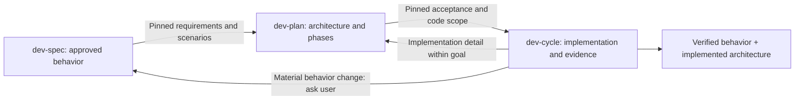

# One feature across three skills



Resolve `SPEC_DIR`, `PLAN_DIR` and `CYCLE_DIR` from installed skill locations; `CYCLE_DIR` is the directory containing dev-cycle's main SKILL.md and scripts. Do not assume all three are sibling directories. `RUN` is a task-local scratch directory, `REPO` the absolute checkout. Commands have `--help`; do not recreate their transformations manually. Use the explicit root URI from the task/handoff, or scoped recall and read to find the relevant current ready artifact. Ask only if multiple plausible active revisions remain ambiguous. Preserve existing answers and references instead of restarting interviews.

## Spec to plan

```sh
python3 "$SPEC_DIR/scripts/dev_spec.py" export-plan --root "$SPEC_URI" --out "$RUN/spec-input.json"
python3 "$PLAN_DIR/scripts/dev_plan.py" inspect --repo "$REPO" --path src/area --out "$RUN/plan-scope.json"
python3 "$PLAN_DIR/scripts/dev_plan.py" from-spec --packet "$RUN/spec-input.json" --scope "$RUN/plan-scope.json" --out "$RUN/plan.json"
```

The importer checks active native memories and pinned content, then initializes an **incomplete** development plan. The planner still understands source, recalls additional relevant context, creates current/target architecture, chooses phase boundaries and specifies real verification methods. It preserves the `spec` block, requirement IDs and exact scenario criteria. Each acceptance item maps at most one spec scenario through `specScenarios`; extra implementation acceptance may map none. All approved scenarios must remain covered. Constraints and exclusions stay attached as authoritative upstream context.

Moving a scenario between phases is allowed. Deleting/weakening an obligation or changing a key external contract requires revising the spec with the user, exporting its new revision, and reconciling the plan. Do not mutate the upstream `spec` block to hide drift. A source-only refresh can preserve intent confirmation; a semantic revision cannot.

## Plan to cycle

After the plan is ready and persisted, use `dev_plan.py export-dev-cycle --root URI --delivery local|commit|pr --bindings FILE --out DIRECTORY`. It creates `DIRECTORY/plan.json` and `DIRECTORY/memory-content.json`. Bindings map phase IDs to explicit `branch` and `baseBranch`; retain the task's actual delivery authorization. This export does not create branches or publish anything.

Use the exported map even for a single phase when upstream memories exist. Standalone tiny dev-cycle work still needs no spec/plan ceremony. The map carries feature identity, spec revision, native memory hashes, phase dependencies, acceptance IDs/scenario mappings, and completion root. Keep those fields when updating dynamic phase state. The phase helper includes them in its static definition hash, snapshots and bounded worker packet.

Every `phase_state.py ready` records the actual validation file, its content hash and the plan definition hash. Acceptance results must contain actual observed evidence. Keep validation files until knowledge closeout; do not replace them with self-assessed completion. Revisions require fresh packets and affected verification; never relabel old evidence as testing a new obligation. Existing PR, sharing, review and publication gates still apply.

## Coordinated implementation closeout

Once all phases have passed validation, inspect the final combined source. Refresh graph evidence for new/changed code. The coordinator requires passing acceptance for the **actual current combined Git tree**, including uncommitted source. Final feature criteria are all approved dev-spec scenarios; temporary migration/phase criteria remain verified historical evidence for their own phase. Without a spec, all phase criteria are used. A current phase receipt covering every final feature criterion can be reused. Otherwise run combined feature acceptance and supply `prepare --validation FILE` with the same validation shape as dev-cycle: current `snapshotTree`, current cycle `planHash`, `status: passed`, `productState: working`, actual checks and one passing evidence item per distinct final criterion. Old phase evidence alone cannot validate a changed or integrated final tree. Keep run artifacts outside the checkout or in its excluded `.context/dev-cycle/` directory.

For combined checks, use `workflow.py validation-input` with the same `--cycle-plan`, script directories and `--scope` arguments, and a scratch `--directory`. It generates `combined-input.json` with the actual tree, plan hash and every feature criterion marked pending. Fill only observed results/check evidence, then pass that file to `prepare --validation`; do not manually reconstruct IDs or claim the generated pending entries passed.

```sh
python3 "$PLAN_DIR/scripts/dev_plan.py" inspect --repo "$REPO" --path src/area --out "$RUN/final-scope.json"
python3 "$PLAN_DIR/scripts/workflow.py" prepare --cycle-plan "$RUN/cycle-plan.json" --cycle-scripts "$CYCLE_DIR/scripts" --spec-scripts "$SPEC_DIR/scripts" --scope "$RUN/final-scope.json" --directory "$RUN/completion"
```

Read the generated files. The coordinator retains the checked `combined-validation.json` and derives acceptance evidence from it. Reconcile `implemented.json` with the actual final design, add current native `codeRefs` (including newly created code), and fill `evidence.json.architectureVerification`. With upstream spec, fill `spec-evidence.json.codeRefs` and `behaviorVerification` from final combined checks. Record unresolved behavioral deviations; they block completion. Do not invent evidence to fill blanks. `architectureUri` is supplied by the coordinator. Both artifacts must describe the same inspected final scope. `finish` checks the current tree again; code changes require fresh validation and preparation before retirement.

```sh
python3 "$PLAN_DIR/scripts/workflow.py" finish --cycle-plan "$RUN/cycle-plan.json" --cycle-scripts "$CYCLE_DIR/scripts" --spec-scripts "$SPEC_DIR/scripts" --directory "$RUN/completion"
```

The coordinator preserves implemented architecture, retires owned obsolete architecture/plan artifacts, preserves verified behavioral/domain memories with actual code citations, retires owned spec drafts/history, and reconnects architecture to the active verified spec. Archived lineage stays in history maps/body links. Current code binding and verified readback precede retirement for each artifact family. Unrelated recalled memories are never retired. Interrupted writes use retained transaction receipts and optional native `--recover-uri`; rerun `finish` with the same inputs to resume.

Completion returns `implementedArchitectureUri` and `verifiedSpecUri` and records them in `cycle-plan.json.knowledgeCloseout`. These are reusable facts about validated implementation, not proof that a PR merged or a deployment happened. Report delivery status separately. For standalone dev-plan work, its existing `closeout.py` remains supported; spec-backed work uses this coordinator so no behavioral knowledge is left pointing at retired planning artifacts.

## Revision routing

| Discovery                                                    | Owning action                                                               |
| ------------------------------------------------------------ | --------------------------------------------------------------------------- |
| Scope, behavior or external contract must change             | dev-spec interview/confirmation, then re-import and reconcile dev-plan      |
| Architecture or phase order changes within approved behavior | dev-plan revision, re-export affected cycle definition                      |
| Implementation bug against unchanged acceptance              | dev-cycle fix and revalidate                                                |
| Stale source or recalled claim                               | Inspect actual evidence, refresh relevant pins, regenerate affected packets |
| Work is incomplete or interrupted                            | Keep active artifacts and private handoff; never claim verified closeout    |

No stage starts another stage beyond the user's task authorization. Material contract questions go to the user; routine implementation details remain autonomous. Retained verified spec and architecture can be recalled together for future work on the same area.
