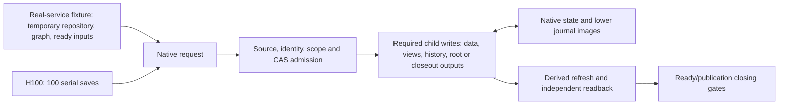
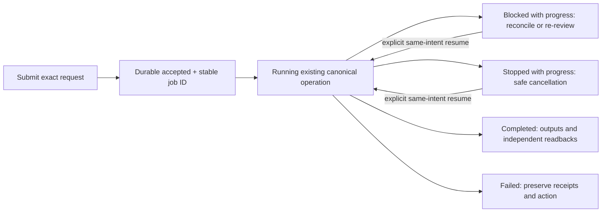

# Native workflow work model and job contract

This is the phase-1 M2/M3 decision from source `c4af8229`, retained as the cost and contract basis for the native job rollout. The job and admitted-source contracts below describe that original decision. Private compiled smokes on `8cc0b9e3` and `36ed5c83` exercised the implemented path, and the manual full-retention tier completed on exact source `36ed5c8360d6d6cf7ba8e07dd60bb5bf75eeb7b0` / tree `293ec7026796891f2341a174eae88163bcea5347`. Moving work to a worker reduces caller occupancy and makes interruption recoverable; these observations do not demonstrate reduced canonical work or a CPU or wall-time speedup.

## Workload and bottleneck map

| Class                        | Account                                                                                                                                                                                                                                                  | Basis                                                                                                                                                                                                                                                      |
| ---------------------------- | -------------------------------------------------------------------------------------------------------------------------------------------------------------------------------------------------------------------------------------------------------- | ---------------------------------------------------------------------------------------------------------------------------------------------------------------------------------------------------------------------------------------------------------- |
| Fixture setup                | Real Git repository, graph preparation, ready plan/spec and controller seeding precede closeout actions.                                                                                                                                                 | [Fixture sources](../apps/threadnote/test/dev-skills/native-closeout-fixture.ts) and historical CBB short-case packets.                                                                                                                                    |
| Required domain work         | Authoring validates source, reserves capacity, writes data/index pages, semantic views, prior history and root, then reads back. Closeout verifies pinned/owned revisions, preflights archives and outputs, enforces approval, publishes and reads back. | [Authoring](../apps/threadnote/src/workflow_automation/authoring.ts#L1120-L1162), [closeout inputs](../apps/threadnote/src/workflow_automation/closeout_inputs.ts#L73-L107), [closeout](../apps/threadnote/src/workflow_automation/closeout.ts#L237-L324). |
| Source/Git and citation work | Binding, clean HEAD/tree, exact-current graph, citation source bytes and closing observations protect identity and publication.                                                                                                                          | [Binding](../apps/threadnote/src/workflow_memory/profile.ts#L69-L140), [citation capture](../packages/context/src/citation/capture.ts#L345-L430), [publication](../apps/threadnote/src/workflow_memory/publication.ts#L428-L444).                          |
| Repeated whole-image work    | Native state writes validate and serialize the complete state; lower journal compact serialization traverses every operation and prepared/committed transitions write images. This can grow with retained history.                                       | [Native store](../apps/threadnote/src/workflow_automation/store.ts#L96-L165), [journal storage](../apps/threadnote/src/workflow_memory/journal_storage.ts#L60-L121), [journal transition](../apps/threadnote/src/workflow_memory/journal.ts#L384-L410).    |
| Instrumentation              | Historical inclusive spans and a runner-only CPU profile locate activity but cannot assign exclusive worker CPU, disk, codec, Git or recall time.                                                                                                        | Retained CBB diagnostic packets and isolated Windows profile receipt.                                                                                                                                                                                      |

### Measurements and provenance

| Dataset                                                     | Observation                                                                                                                                                                                                                                                                                                                                                                                                                     | What it establishes                                                                                                                                                                                       |
| ----------------------------------------------------------- | ------------------------------------------------------------------------------------------------------------------------------------------------------------------------------------------------------------------------------------------------------------------------------------------------------------------------------------------------------------------------------------------------------------------------------- | --------------------------------------------------------------------------------------------------------------------------------------------------------------------------------------------------------- |
| PR916 main-derived Linux H100, CI run `40673181543`         | 100 real revisions passed in 465,594 ms.                                                                                                                                                                                                                                                                                                                                                                                        | The full retention workload itself takes minutes on Linux.                                                                                                                                                |
| PR913 `5ccbaf3` isolated Windows H100, run `40668147005`    | At 600 s, 80 saves had started and 79 succeeded; history traversal had not begun. The captured CPU profile covered runner stacks only.                                                                                                                                                                                                                                                                                          | The timeout occurs in repeated saves, not in history reads; worker CPU attribution is unknown.                                                                                                            |
| Historical CBB full-suite Windows H100 packet               | At 601.7 s, 81 saves started, 80 succeeded, with no history reads. Its 80 saves recorded 1,043 lower saves, 1,223 journal writes, 3,939 manifest reconciliations, 2,408 binding verifications, 2,411 commands, 717 identity projection loads and 81 derived refreshes.                                                                                                                                                          | Operation counts belong **only** to historical CBB code/runner, not the isolated run or current main. Inclusive spans overlap and cannot be summed.                                                       |
| Historical CBB 30 s short closeout packets                  | Fixture setup took about 10.6–13.7 s; first production finish then reached the deadline in several cases.                                                                                                                                                                                                                                                                                                                       | Setup and actual closeout both consumed the case budget; no single exclusive culprit was measured.                                                                                                        |
| P0 main-derived cloud closeout 120 s packet                 | Initial two authoring saves succeeded; one case recorded about 1,520 command-wrapper invocations and about 97 s inclusive command spans, versus 384 ms native-state and 140 ms lower-journal write spans in that case.                                                                                                                                                                                                          | Timeout was in later cloud-closeout actions. The generic facade and overlapping spans do not isolate the subphase or transfer to H100.                                                                    |
| Earlier Intel real closeout                                 | At 180 s, outputs were verified and 6 of 11 archives completed; a 600 s allowance passed without product change.                                                                                                                                                                                                                                                                                                                | A caller deadline can expire after durable partial progress.                                                                                                                                              |
| Exact `8cc0b9e3` compiled desktop job smoke                 | On macOS arm64 with Bun 1.4.2, a clean committed private fixture accepted a source-backed authoring save in 2,064 ms and completed in 3,295 ms. The extracted same-executable worker produced a full root/readback; same-intent retry retained the job ID and the worker lock released. A read-only post-retry inspect found exactly four canonical operations, all verified with four distinct IDs and `needsRecovery: false`. | This is one tiny document and one save on one host, not H100, Windows qualification, a matched synchronous comparison, or evidence of reduced total work.                                                 |
| Exact `36ed5c83` manual H100, CI run `40786503429`          | The Linux H100 case ran for 378,684 ms in job `123160922190`; the Windows H100 case ran for 1,014,660 ms in job `123160922413`. Each passed the original 100 serial saves, 100 history roots, and state-conservation assertions.                                                                                                                                                                                                | Both full-retention workloads passed on hosted runners at the same source/tree. Their elapsed times are hosted-run observations, not an exclusive OS effect or matched algorithm before/after comparison. |
| Exact `36ed5c83` manual Windows cloud, CI run `40786503429` | The Windows cloud test file ran for 595,240 ms in job `123160922488`; its four case durations were 148,396, 151,467, 96,350 and 199,023 ms. All cases passed with original authority, publication and recovery assertions in force.                                                                                                                                                                                             | The four cloud cases completed within the manual qualification budget on this runner; this does not isolate where their time was spent.                                                                   |
| Exact `36ed5c83` compiled desktop job smoke                 | On macOS arm64, the clean committed private fixture accepted a source-backed job in 2,702 ms and completed in 6,004 ms. Full-document equality, independent native readback, four distinct verified operations, same-ID retry and worker-lock release passed without Node or Bun on `PATH`.                                                                                                                                     | This verifies a tiny same-executable job path at the qualified source, not saved-work or H100 speedup, Windows job acceptance, or a synchronous baseline.                                                 |

The `36ed5c83` observations used Bun 1.4.2. These datasets use different source and runner versions; they are not a paired before/after study. The historical CBB packets, current P0 packet, CI run receipts and exact-source compiled smoke proofs are retained with the investigation, not reproduced here. The compiled smokes do not identify an exclusive storage cost; completed manual qualification establishes workload completion, not reduced work.

### Operation and byte bounds

An authoring save plans `p + ceil(p/8) + ceil(p/64) + v + h + 1 + c` child operations: `p` UTF-8 data pages, `v` semantic views, `h` one prior-root history snapshot on replacement, and `c` one context artifact when evidence references exceed eight ([source](../apps/threadnote/src/workflow_automation/authoring.ts#L1143-L1162)). The document limit is 1,000,000 canonical UTF-8 bytes; pages are at most 20,000 bytes ([serializer](../apps/threadnote/src/workflow_automation/authoring_artifacts.ts#L100-L110)). The **current approved plan document**, serialized purely with the pinned canonical serializer, is 24,967 bytes, two pages and four views: nine planned children on its initial save, ten on replacement, with zero evidence references. This is a document shape calculation, not a measurement of the H100 fixture or a count of external setup work.

The native protocol caps retained operations at 4,096 ([source](../packages/workflow-automations/src/native.ts#L15)); the native state file has a 16 MiB stored limit ([source](../apps/threadnote/src/workflow_automation/store.ts#L90-L92)); lower journal limits are 16 MiB stored and 64 MiB logical ([source](../apps/threadnote/src/workflow_memory/journal_codec.ts#L4-L6)). Admission budgets content, evidence, scope and metadata bytes before child effects ([source](../apps/threadnote/src/workflow_automation/authoring.ts#L1199-L1235)). Exact per-revision H100 image bytes, compressed bytes, read amplification and exclusive whole-image time were not retained. Repeated full-image traversal suggests growing cumulative work; it does not prove that storage dominates elapsed time.

## PR913 disposition

PR913 `5ccbaf3` changed 92 paths against comparison baseline `b53e3ac` (+9,192/−2,120 lines), the merged PR916 P0 commit. It is a checkpoint, not a merge unit. The following decisions preserve behaviors; a retained item still needs selective review and qualification against current main.

| Decision                    | Changed groups and reason                                                                                                                                                                                                                                                                                                                                                                                                                              |
| --------------------------- | ------------------------------------------------------------------------------------------------------------------------------------------------------------------------------------------------------------------------------------------------------------------------------------------------------------------------------------------------------------------------------------------------------------------------------------------------------ |
| **Retain selectively**      | Exact source/dirty/unmerged refusal, amended-review recovery, historical review decoding, source/citation identity, lost-ack recovery, closeout preflight/CAS/final readback, and checked mutation invariants with focused regression tests. The required separate simplicity/slop/DRY review lane and orchestrator-only handoff ownership are already approved policy; preserve historical decode compatibility while reviewing exact schema changes. |
| **Defer**                   | V2 text-page representation, request-local citation-session reuse, combined Git observation, fresh-document/projection shortcuts, recall identity/index/client leasing/batch restructuring, journal image reuse and gzip changes. Source suggests potential repeated work but the retained datasets give no paired current-main benefit or exclusive attribution; none is required for the thin job contract.                                          |
| **Drop from this delivery** | Manager library search/navigation removal, temporary profile/progress instrumentation, stale Windows/Bazel/CI policy changes and weakened E2E assertion. Current main CI policy remains authoritative; isolated fixture fixes can be reviewed independently.                                                                                                                                                                                           |

## Approved phase-2 contract: two decisions

### 1. Admitted source view and live promotion

**Before `accepted` (proposed):** Admit only opt-in, clean committed source in the original bound repository. Reject dirty state, missing objects, qualified/cross-repository references that cannot be fully retained in v1, and unsupported citation forms with a capability result before canonical mutation. Durably store and independently read back the exact request and its digest, run/generation/logical binding, expected target revisions and plan/spec pins, original repo/worktree identity, HEAD and tree, required commit/tree/blob bytes and hashes, and exact citation snapshot/provenance plus source bytes or capsules for every admitted reference. A queue row without this witness is not acceptance. Authoring currently inspects 1–128 canonical relative files of at most 1,000,000 bytes each and compares their hashes and HEAD ([source](../apps/threadnote/src/workflow_automation/authoring.ts#L149-L200)); citation capture currently requires a published exact-current graph and retains capsules with a before/after fence ([source](../packages/context/src/citation/capture.ts#L175-L245), [closing fence](../packages/context/src/citation/capture.ts#L544-L599)). The admitted witness must preserve the original citation commit/snapshot identity; old graph evidence is never described as current.

**During admitted child execution (proposed):** Pass an internal, immutable source view explicitly to authoring source validation and lower citation preparation/source reading. It reads only retained, hash-verified bytes and provenance; it cannot choose a new repository path. Keep `binding.repo`, `callerCwd`, checkout identity and `bindingId` tied to the original logical repository ([binding derivation](../apps/threadnote/src/workflow_memory/profile.ts#L69-L140), [lower capture call](../apps/threadnote/src/workflow_memory/artifacts.ts#L338-L375)). A temporary materialization path may be an implementation detail, never a binding or citation identity substitute. Existing operation preparation, journal receipts, identity/CAS checks and independent readback remain canonical ([executor](../apps/threadnote/src/workflow_automation/index.ts#L280-L361), [lower write](../apps/threadnote/src/workflow_memory/artifacts.ts#L520-L556)). Synchronous calls keep their live-source path.

**At ready/final/publication (proposed):** Re-enter live admission against the original binding and clean current HEAD/tree, exact target revisions/CAS, pinned plan/spec and owned artifact revisions, and approval digest. In v1 **any** changed HEAD, including an unrelated commit, yields durable `blocked-with-progress` and a named reconcile/re-review action; admitted child receipts remain intact. Keep the lower citation `requireExactCurrentSnapshot`/before-after fence and publication `revalidateCitations` and `assertWorkflowPublicationVerified` on the live path at the actual closing write ([citation](../packages/context/src/citation/capture.ts#L716-L733), [publication](../apps/threadnote/src/workflow_memory/publication.ts#L428-L444), [verified publication](../apps/threadnote/src/workflow_memory/publication.ts#L659-L673)). An outer HEAD check alone does not close the time-of-check gap. Authoring root source verification and closeout's live source/owned checks continue at promotion ([root](../apps/threadnote/src/workflow_automation/authoring.ts#L1338-L1349), [closeout](../apps/threadnote/src/workflow_automation/closeout.ts#L379-L429)). A root-owned, explicitly requested canonical handoff is a valid output; workers write no separate handoff memories.

### 2. Stable identity, retry and cancellation

Derive or reuse one job ID from the original binding/run/generation, operation kind and exact request intent; a duplicate submit returns that job and changed intent under its identity conflicts. The envelope records the existing authoring save digest or closeout transaction and canonical reservation/child-ID mapping **before corresponding effects**; it does not pre-execute child writes merely to enumerate IDs. Authoring already derives a save digest and reserves operation capacity before writes ([source](../apps/threadnote/src/workflow_automation/authoring.ts#L930-L948), [reservation](../apps/threadnote/src/workflow_automation/authoring.ts#L1220-L1255)); closeout derives a transaction and child IDs, preflights, then journals before finish ([source](../apps/threadnote/src/workflow_automation/closeout.ts#L233-L324)). Existing operation digests reject changed intent and recover verified effects ([source](../apps/threadnote/src/workflow_automation/index.ts#L280-L359)). No retry silently refreshes source, invents a new operation ID or replays a verified write.

`accepted` means exact input and witness are durable; `running` means the same operation advances; `blocked-with-progress` records failed live source/CAS/authority gates plus verified receipts and a specific action; `stopped-with-progress` records cancellation at a safe boundary without retracting writes; `completed` requires every requested canonical output and independent readback under valid closing gates; `failed` preserves receipts and a recovery action. A client disconnect or worker restart reconciles existing prepared/verified receipts before doing more work. Cancellation never erases a pending journal or releases a reservation as if it had not run. Explicit same-intent resume is allowed only when existing guards admit it. No source-amend, abandon or generic job API is part of this contract. Bounded status/result reads need not decode complete workflow history.

**Promotion guard to implement:** The existing outer source check and citation-capture fence do not guard the later root write. Add a live original-binding HEAD/tree predicate to the canonical lower `writeChecked` callback for root/final-output promotion, then check currentness again with the independent output readback. Drift at either boundary records `blocked-with-progress`, even if an output already exists; it cannot report completion or rollback. Test a HEAD change after outer admission and before the actual write.

**Interruption boundaries:** The durable job request and identity outlive an empty authoring reservation's cleanup. Before replanning, reconcile native and lower prepared/verified receipts, including a stop after closeout capacity reservation but before journal persistence. Observe cancellation before the next canonical child operation; let an in-flight effect finish or reconcile its receipt before recording stopped progress. Cancellation after verified completion returns that completed result.

The decision boundary is reached: implement the reviewed thin private workflow envelope and live promotion seam, then qualify functional and full-retention tiers separately. Any storage optimization requires a distinct demonstrated redundant-work term and must preserve durability, source/currentness, publication and readback fences.
